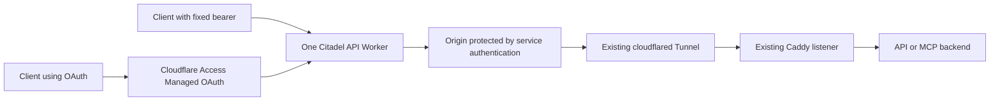

# Cloudflare API and MCP refactoring goal

Status: implementation candidate on `codex/cloudflare-api`; live acceptance is
pending. This goal remains the acceptance contract. It does not activate an
extension, publish a Worker, run a scan, or change live routes by itself.

The live source preview runs behind Caddy on HTTPS port 2000. The prior
Cloudflare management-token permission problem was corrected. That does not
establish an accepted OAuth flow: browser OTP, client callback and refresh
remain to be tested together with the operator.

The access model was revised at the operator's request: explicit CSV grants per
scanned route replace the global bearer and legacy backend registry. A private
WebUI using the existing Citadel token stages those grants for the next full
scan. The previously inserted application token was removed locally and from
Cloudflare; it must not be imported automatically. Tests with that old manual
setup are not evidence for this generic flow. No image build or pull is part
of this source change.

Remaining live acceptance on the authorized preview deployment includes real
nested-domain TLS and Managed OAuth API behavior; a real
client's registration, OTP callback, PKCE/resource binding and token refresh;
read-only MCP checks through both public auth modes; origin rejection without
service credentials and with a forged/wrong-audience assertion; stable Access
IDs and sessions across rescans; and exclusion cleanup while browser OTP stays
functional. The README contains the Blender/OpenCode procedure and the bundled
`functions/mcp_check.py` sends no `tools/call`. Do not mark this goal complete
until those results have been recorded.

## Objective

Add one optional `CLOUDFLARE-API` extension that discovers API and MCP endpoints
on the services already scanned by Citadel and publishes additional protected
Cloudflare URLs. Offer two independent dashboard modes, **API-Bearer** and
**API-OAuth**, through one shared Cloudflare Worker per Citadel installation.
Keep the existing browser URLs and their email/OTP policies intact.

Follow Citadel's existing operating model: scan everything eligible, map the
recognized endpoints automatically, exclude unwanted ports, and scan again.
Do not require a manually numbered list of applications or ports in the
environment. This work concerns Cloudflare; localhost, subnet, Tailscale Serve,
Caddy port allocation, container networking, and connector lifecycle retain
their current responsibilities.

## Extension and the two example files

Ship the extension disabled, at `extensions/disabled/CLOUDFLARE-API/`, with its
own `extension.json`. Moving that directory to
`extensions/enabled/CLOUDFLARE-API/` activates consideration during scans.
The existing Cloudflare extension is actually named
`extensions/enabled/cloudflare/`; keep that name and its existing configuration.
There is no additional environment variable for extension activation.

Keep `CITADEL_TOKEN` and `CLOUDFLARE_API_TOKEN` in `env.example`. Remove
`CITADEL_CLOUDFLARE_API_BEARER`; it is no longer part of the configuration model.
Keep the independent `CITADEL_CLOUDFLARE_API_OAUTH=0` option in
`config.conf_example`, with choices `0 1`. Do not introduce `_N` groups.

Both extension directories and the existing Cloudflare management token are
prerequisites. Discovery runs before any grants exist. It adds empty rows to
private, gitignored `CLOUDFLARE-API_access.json` at the repository root. Only the
empty `.example` file ships. Grant selection is per discovered route ID:

- `email;backendBearer`: OAuth email maps to that backend bearer.
- `outerBearer;innerBearer`: verify the outer bearer, then inject the inner.
- `singleBearer`: verify it at the edge, then forward it unchanged.
- `email`: authorize OAuth without sending backend Authorization.

Commas separate entries and semicolons separate pairs. Reject duplicate
identities within a route. Empty rows publish nothing. Email grants additionally
require OAuth enabled and a valid callback policy. The browser email policy is
separate; it does not grant API access.

At `/cloudflare-api`, provide an editor protected by `CITADEL_TOKEN` for both
reading and writing. Unset token fails closed. Show route identity, current
scan evidence, masked CSV values and whether saved changes are pending. Save
only updates the private JSON; never deploy or scan automatically. The next
successful full scan synchronizes its snapshot, replaces changed mappings and
revokes removed grants. Concurrent edits remain pending; stale editors cannot
overwrite newer saved changes. `--add` preserves existing credentials.

## Stable URLs and dashboard modes

For an illustrative Blender MCP HTTP bridge discovered through Caddy on port
3070 with endpoint `/mcp`, generate:

| Dashboard mode | URL | Authentication |
|---|---|---|
| API-Bearer | `https://api-3070.example.com/mcp` | Fixed client bearer checked by the Worker |
| API-OAuth | `https://oauth.api-3070.example.com/mcp` | Cloudflare Managed OAuth |

The OAuth hostname keeps its `oauth.api-` form even when no bearer is configured.
Use the discovered port and preserve each endpoint path. Multiple endpoints on
one port share the hostname but remain individually visible and copyable.

Attach both hostnames as **Worker Custom Domains** to the same Worker. These
provide certificates for nested hostnames such as `oauth.api-3070.example.com`
without a separate Advanced Certificate Manager subscription. Manage their
certificate readiness and ownership during reconciliation; do not create a
Tunnel CNAME on the same hostname as a Worker Custom Domain.
[Cloudflare Custom Domains](https://developers.cloudflare.com/workers/configuration/routing/custom-domains/#certificates)

The two menu entries are views of one extension, not separately enabled
extensions or separate Workers. Hide inactive modes. Show pending and failed
publication explicitly instead of presenting an unverified URL as connected.
Keep the existing Cloudflare menu and browser routes unchanged.

## Whole-port exclusions

Add `CLOUDFLARE-API_ignore.json` at the repository root, initially:

```json
{
  "ports": []
}
```

To exclude ports after inspecting a scan:

```json
{
  "ports": [3070, 4001]
}
```

A listed port is completely excluded from this extension: all its API and MCP
paths, both authentication modes, and both dashboard views. An empty list maps
all recognized eligible endpoints. There are no per-path, per-URL, wildcard,
or regex exclusions. The ordinary Cloudflare browser route is unaffected.

On the next successful full scan, remove the extension-owned public bindings
for excluded ports and deny their paths in the Worker before removing related
resources. Removing a port from the file makes it eligible again. Validate
integer ports in the range 1–65535. Malformed JSON or invalid entries stop API
publication; they must not become an empty exclusion list. Preserve operator
edits during updates and container refreshes, and document how container
installations supply this repository-relative file.

## Discovery and endpoint inventory

Reuse the normal TCP listener scan and HTTPS-before-HTTP probing. Host Citadel
sees listeners reachable from its own network namespace, including published
Caddy ports. It does not automatically enter a user's Podman network or discover
Unix sockets. Caddy can continue bridging those backends to scanned listeners.

Run bounded endpoint discovery when the extension has an active auth mode.
Start with known MCP paths (`/mcp`, `/api/mcp`, `/api/v1/mcp`, `/api/v2/mcp`),
OpenAPI/Swagger documents, common API roots, and GraphQL endpoints. Follow
same-origin documentation links only within bounded limits. A generic HTML 200
or a bare 401/403 is insufficient proof of a working API or MCP protocol.
Record authentication-required and unknown candidates with their evidence.

Produce a normalized inventory with stable route IDs, original port, origin
scheme, endpoint path, protocol, discovered operations/path scope, authentication
requirements, and probe status. Publication is automatic for recognized,
non-excluded endpoints whose prerequisites are satisfied. Report candidates
that need backend credentials instead of guessing their secrets or claiming
that arbitrary APIs can all be discovered from their URL names.

MCP discovery and connection checks may use `initialize`, the initialized
notification, and `tools/list`; never execute `tools/call`. REST/OpenAPI and
GraphQL probes must also be read-only. Version 1 must support MCP Streamable
HTTP including SSE responses, REST HTTP, and GraphQL over HTTP. Explicitly
report unsupported transports instead of advertising them as working.

## Authentication and forwarding



The Worker accepts only configured hostnames and the endpoint paths belonging
to their scanned routes. It is not an arbitrary URL proxy. Disable alternative
`workers.dev` and preview entry points or reject them identically. The shared
route table must deny unknown paths, Citadel's own management API, and attempts
to escape path restrictions through encoding, traversal, or redirects.

### Fixed bearer

Store route-bound HMAC verifiers in Worker Secrets and validate the supplied
bearer before forwarding. Missing or invalid credentials produce a machine-readable
401 without contacting the host. Cloudflare Access does not automatically
validate an arbitrary bearer; the Worker does. No bearer has installation-wide
access. Pair entries select an inner token; single entries explicitly authorize
passing the verified client token through.

### Optional Managed OAuth

Attach Access with Managed OAuth to the OAuth hostnames only, so the fixed
bearer URLs remain usable. Build each hostname's Access email policy from its
route grants, then enforce the exact route/email mapping in the Worker. Cloudflare performs login,
token issuance, and refresh. The Worker validates the signed
`Cf-Access-Jwt-Assertion`, including issuer, audience, signature, and expiry,
and checks the current route identity policy before forwarding.
Do not decode the opaque client access token as though it were a JWT.
[Cloudflare Managed OAuth](https://developers.cloudflare.com/cloudflare-one/access-controls/applications/http-apps/managed-oauth/)

Use short access-token lifetimes, initially five minutes. Configure explicit
client callback permissions; localhost and loopback registration are off by
default and require a deliberate client-specific opt-in. OpenCode's container
callback is part of the documented setup, not an implied ability to type OTP
into a CLI. Verify target clients' discovery, registration, PKCE, and resource
indicator support before claiming compatibility. Keep registration settings in
extension-owned policy metadata rather than introducing more global env vars.

Cache signing keys with bounded lifetime and refresh on an unknown key ID.
Check each request, including requests carrying an existing MCP session ID.
Bind session handling to the authorized principal and route so another route
or identity cannot reuse it. Use per-identity or per-bearer rate controls, not
the Tunnel's loopback IP as a user identity.

### Origin and backend credentials

Use a separate, extension-owned origin hostname per port, protected by
Cloudflare service authentication. The Worker supplies those machine credentials
to reach the Tunnel origin. Do not weaken the original email/OTP route to make
Worker fetches work. The origin must reject a request that bypasses the Worker
without valid service credentials; preserve origin assertion validation where
the connector supports it. The Tunnel still targets the existing Caddy
listener, not a Podman-only address unreachable from host cloudflared.

Backend authentication is selected by the explicit matching grant. Remove
client Authorization and untrusted identity headers before injecting the selected
backend bearer. A bare email grant forwards no Authorization. Never guess tokens,
copy them from application configuration, or use the management token upstream.

Keep CSV values only in the private mode-0600 root access file and Worker Secrets.
Public inventory, health responses, route tables and logs contain no credentials.
The token-protected editor is the only WebUI that may read or write the values.
Use the first explicitly configured backend token for each route's discovery
probes, never send it to another route. A protocol check does not validate every
user's backend token. Full scans must explicitly delete obsolete secret bindings
because Cloudflare may retain secrets omitted from an upload. Changed grants
also invalidate MCP sessions bound to their previous revision.

Stream requests and responses without buffering complete MCP/SSE streams.
Preserve protocol headers and cancellation. Do not follow upstream redirects
with credentials or leak upstream secrets in errors and response headers.

## Code factoring

Keep Cloudflare resource changes separate from discovery and UI rendering.
The existing `functions/providers/cloudflare_api.py` is the Cloudflare API client;
do not repurpose its name for the new API-routing extension.

| Component | Responsibility |
|---|---|
| `extensions/disabled/CLOUDFLARE-API/extension.json` | Optional extension manifest; implementation ID `cloudflare_api_routes` |
| `functions/api_discovery.py` | Bounded read-only detection and normalized endpoint inventory |
| `functions/cloudflare_api_access.py` | Private grant registry, CSV validation, scan snapshot, secret compilation and editor state |
| `webui.py`, `templates/cloudflare-api.html`, `assets/cloudflare-api.*` | Token-protected grant editor; save for next scan only |
| `functions/cloudflare_api_policy.py` | Mode matrix, whole-port exclusions, route identity, auth policy and secret references |
| `functions/cloudflare_plan.py` | Pure desired-state planning for ordinary Cloudflare routes and API routes together |
| `functions/cloudflare_apply.py` | One locked inventory/diff/apply coordinator for DNS, Tunnel, Access, Worker and domains |
| `functions/providers/cloudflare_api.py` | Existing API transport extended with Worker, Secret, Custom Domain, service-token and Access update operations |
| `functions/providers/cloudflare.py` | Existing provider entry point adapted to shared planning/apply |
| `functions/providers/cloudflare_api_routes.py` | Extension adapter and two mode views; no independent Tunnel writer |
| `workers/cloudflare-api/` | Worker routing, authentication, origin credential injection and streaming |
| `functions/providers/dispatch.py`, `functions/core.py`, `templates/index.html` | One extension yielding multiple endpoint links and two dropdown modes |
| `functions/runtime_state.py`, `functions/health.py`, `index.js` | Runtime output, auth-aware health, and consistent plugin route presentation |

Retain the existing scan lock. All selected Cloudflare participants contribute
to a combined desired state before a single apply phase. A normal scan, an API
scan, or an ordinary Cloudflare-only scan must not overwrite the other mode's
live bindings. Snapshot local configuration and complete remote pagination
before planning destructive operations. Unchanged scans perform no writes.

Preserve append-only `--add`: it must not reset, remove, or replace existing
routes. A changed ignore file or disabled mode is applied by a full scan;
report that pending removal explicitly during Add. Keep `--del` and Tailscale
reset semantics outside this feature.

Use stable resource ownership derived from the configured account, zone, and
dedicated Tunnel, with supported API metadata and explicit collision checks.
Another installation must not take over an existing Worker, DNS record, app,
or policy just because its name matches. Reconstruct remote inventory from
Cloudflare rather than depending on disposable route output as an ID ledger.

Update Access applications in place. GET the current object, merge the intended
changes while preserving unrelated writable settings, then PUT the complete
update payload. Preserve app IDs/audiences and client registrations on normal
rescans. Full rebuild mode must not silently rotate OAuth identity or delete
the sibling mode; intentional credential replacement needs an explicit action.

Provision protection before publishing URLs. On removal, deny the route before
retiring its owned resources. Validate and deploy a complete Worker route table
as one configuration version. Check platform limits before applying. Failure
must leave a known protected configuration, not a public fallback.

Fix the existing implicit-public fallback as part of the factoring: a newly
discovered ordinary Cloudflare port without an explicit rule and without valid
default emails must not be published as `whitelist: false`. Preserve deliberate
existing public rules. Add regression coverage before changing the provider.

## State, disable behavior and operational boundaries

Generated endpoint inventory and API route output belong in `cache/`; private
access configuration belongs in the private root JSON. Machine secrets remain
in the ignored persistent data directory. Root access, discovery and ignore
files are operator state and must survive refreshes. Publish no
secrets to the existing health API or OpenClaw route output.

Turning a mode off, removing its bearer, or moving the extension to disabled
must cause the next successful full reconciliation to retire that mode's owned
public routes. The cleanup coordinator must discover these resources even when
the extension directory is no longer enabled. Keep the remaining auth mode and
ordinary browser routes intact.

Without a working management token, Citadel cannot revoke already published
Cloudflare resources. Report cleanup as pending and remote state as unverified;
never claim that removing a local value immediately revoked a remote token.
Do not remove protection to recover from configuration or API errors.

This feature does not start, stop, or restart cloudflared, Caddy, Podman, or
systemd services. Use GitHub Actions workflows from `SCRIPTS/githubactions` for
image builds, substantial image tests, smoke tests, and restart tests. Do not
build images or start test containers on core/rafael infrastructure. Image pulls
and local adoption remain separately requested Smart1 operations. Retain the
agreed Fedora image pins and other existing image-reference rules.

## Implementation sequence and acceptance

1. **Prove the protocol and ownership assumptions.** Exercise Managed OAuth
   discovery, registration, refresh, nested Worker domains, service-protected
   origin forwarding, and a real OpenCode callback in an isolated integration
   setup. Record actual client results rather than promising every Web UI works.
2. **Factor ordinary Cloudflare reconciliation.** Introduce plan/apply and the
   missing-email regression test, preserve current browser behavior, and prove
   resource ownership, pagination, locking, Add semantics and in-place updates.
3. **Add extension policy and discovery.** Keep the OAuth flag, add the private
   per-route grants and token-protected editor, whole-port ignore file, protocol
   detection, bounded requests and actionable missing-credential results.
   Test saving versus applying, concurrent edits and removed grant cleanup.
4. **Implement the Worker and protected origins.** Test bearer rejection and
   success, route/path boundaries, secret injection, streaming, cancellation,
   session isolation and rejection of direct unauthenticated origin access.
5. **Add optional OAuth.** Test missing/forged/expired assertions, wrong audience,
   another app in the same team, signing-key rotation, allowed identities,
   callback restrictions, token refresh and OAuth-only operation with no bearer.
6. **Integrate presentation and lifecycle.** Show two modes from one extension,
   retain all endpoints per port, reconcile exclusions and removals, report
   pending cleanup, and keep ordinary Cloudflare, localhost, subnet, Tailscale
   and Caddy behavior covered by regression tests.
7. **Finish operator documentation.** Maintain the README's Blender example,
   explain URL versus local MCP name, browser OTP and the container callback,
   distinguish every credential, document permissions and private state backup,
   and remove the planned-feature notice only after implementation is complete.

Completion requires meaningful automated tests plus a documented read-only
connection check through both public auth modes. A full scan repeated without
changes must preserve Worker identity, Access app IDs and OAuth sessions. An
ignored port must disappear from both API modes after full reconciliation,
and its old API URLs must reject access while the original browser route still
works. No test may call a Blender operation, mutate an application's data, or
silently publish a route after an auth failure.

## Related documentation

- [Blender and OpenCode walkthrough](README.md#planned-cloudflare-api-and-mcp-access)
- [Existing Cloudflare setup](CITADEL_CLOUDFLARE.md)
- [Cloudflare hostname-specific Worker protection](https://developers.cloudflare.com/workers/configuration/cloudflare-access/)
- [OpenCode MCP configuration and authentication](https://docs.opencode.ai/docs/mcp-servers/)
